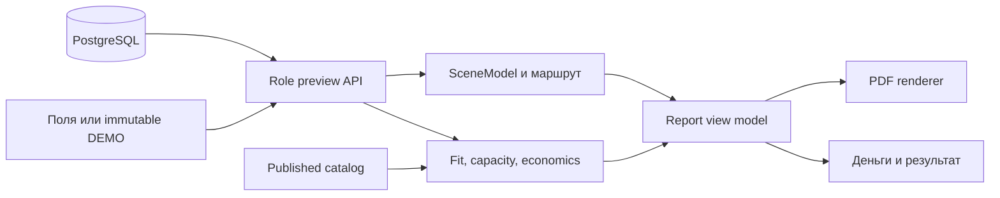

# Поток данных текущего приложения

`frontend/src/App.jsx` управляет пятью шагами. Готовые примеры определены в `frontend/src/showcasePresets.json` и передаются в те же preview, route-preview и PDF API, что и введённый пользователем сценарий. Пресеты неизменяемы в интерфейсе; их цены и типы роботов являются маркированными предположениями.

`backend/main.py` подключает FastAPI routers. `backend/warehouse_roles_api.py` и `backend/object_roles_api.py` валидируют роли и строят preview через `backend/calculation/`. Route-preview использует `SceneModel` и файлы `data/scenes/*.scene.json`. Физическая пригодность, парк и финансовые показатели считаются на сервере; клиент не подменяет NPV. `role_report_view.py` предоставляет единое представление для интерфейса и PDF; `role_report.py` его оформляет.

`discovery` опубликованного каталога обеспечивает просмотр, `capacity` — подтверждённые входы нового расчётного маршрута. `runtime` для legacy-подбора требует отдельной пригодной проекции. Когда паспорт или цена модели не подтверждены, сценарная демонстрация допустима, но её финансовые числа не являются закупочной рекомендацией.

Курсор playback и кнопки 1×/2×/4×/8× живут только во frontend. Они используют рассчитанный маршрут, не меняют физический расчёт, суммы и ревизию. При изменении пользовательских входов preview вызывается заново. Проекты, расчёты, сцены RobCraft, версии и согласия хранятся в PostgreSQL; изменяющие запросы защищены сессией, правами и CSRF.
