# 2. Визуальный разбор

Исторические скриншоты показывают локальную сборку конца сентября. Кадры `new-*` ниже показывают обновлённую локальную сборку от 17.10. По ним нельзя судить о production или о поведении всей анимации.

## Первый этап после консультации

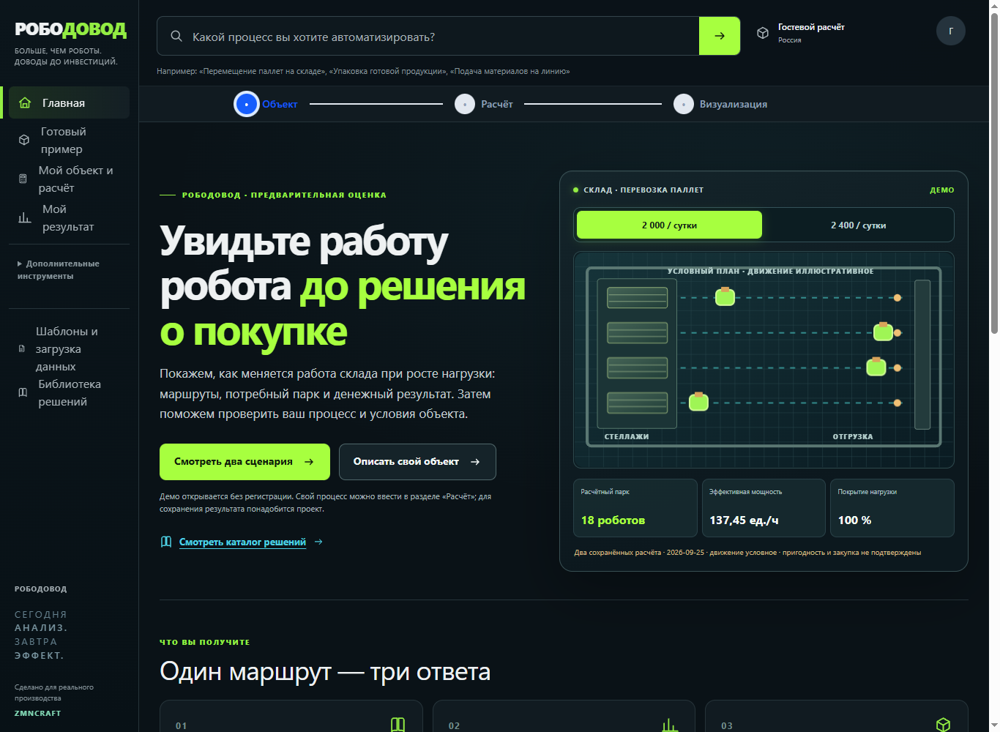

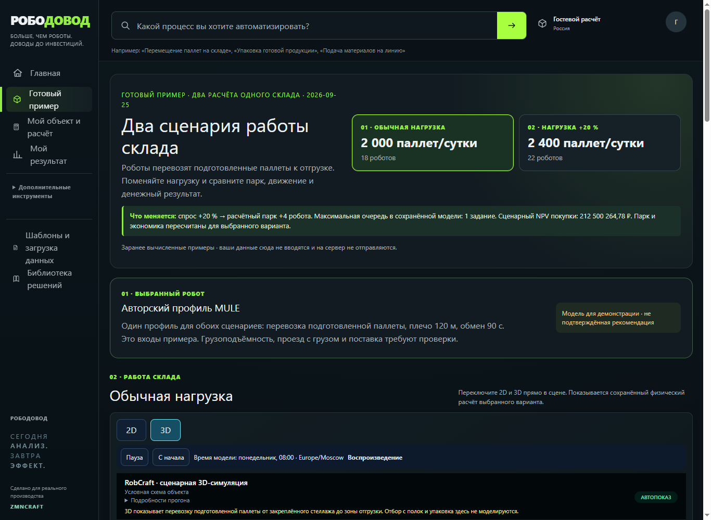

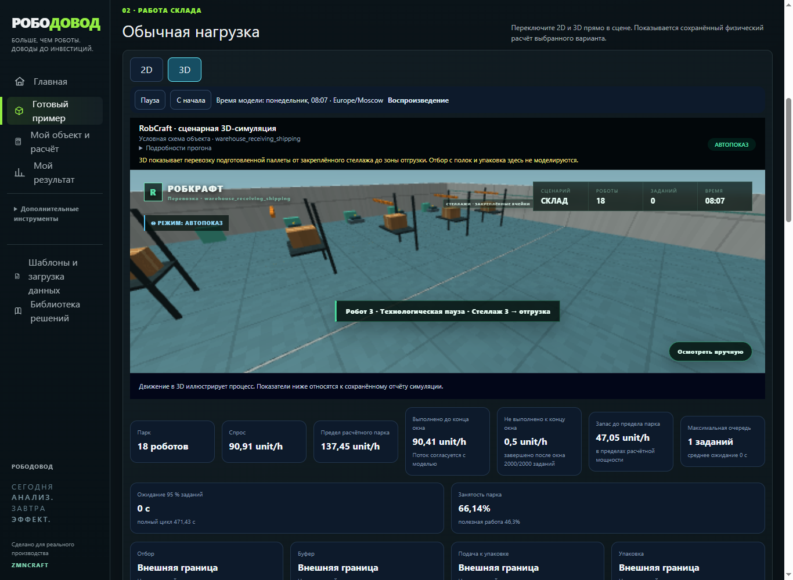

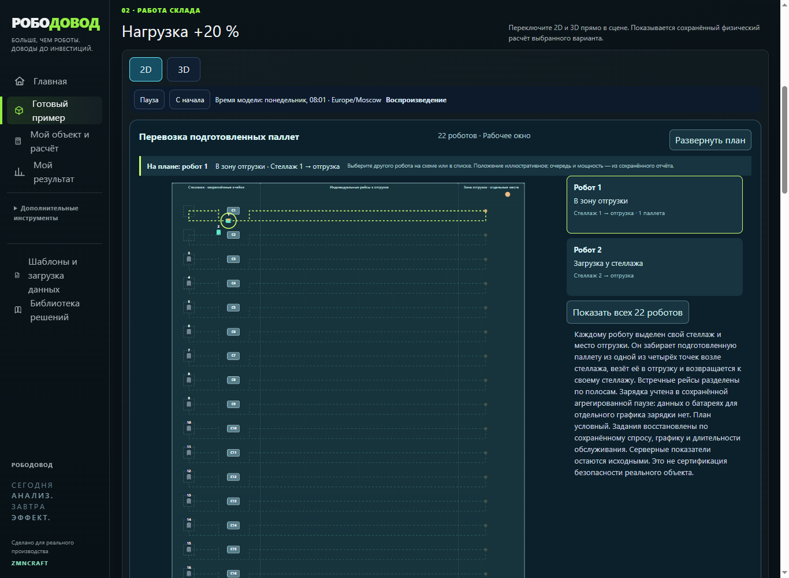

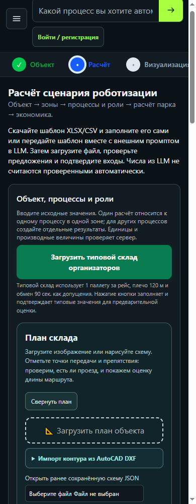

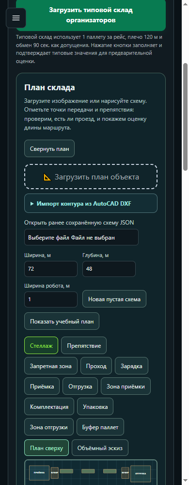

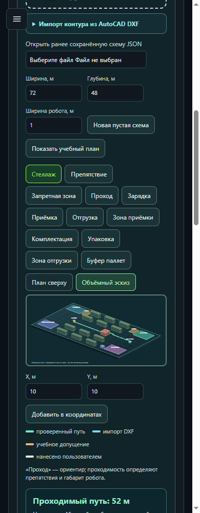

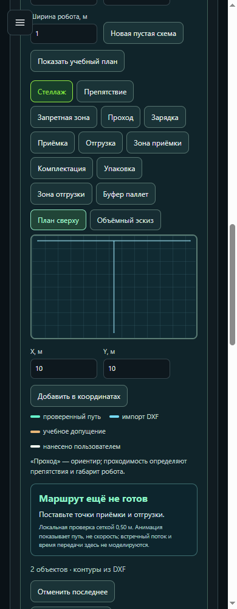

Новый вход сразу даёт два понятных варианта и выводит сцену перед финансовыми таблицами. Компактный просмотр убрал часть повторяющихся органов управления, а камера 3D быстрее приближается к роботу. Конструктор теперь проверяет предварительный путь, синхронно показывает его сверху и в объёмном виде, может отправить **только длину** в новый серверный расчёт и сохранить снимок геометрии рядом с результатом. Центральная проблема доверия остаётся: гостевой условный склад и регулярный 2D-план всё ещё не похожи на помещение конкретного заказчика. Референсный план отдельно маркирован как авторский, не геометрия гостевых чисел.

## Склад: 2D

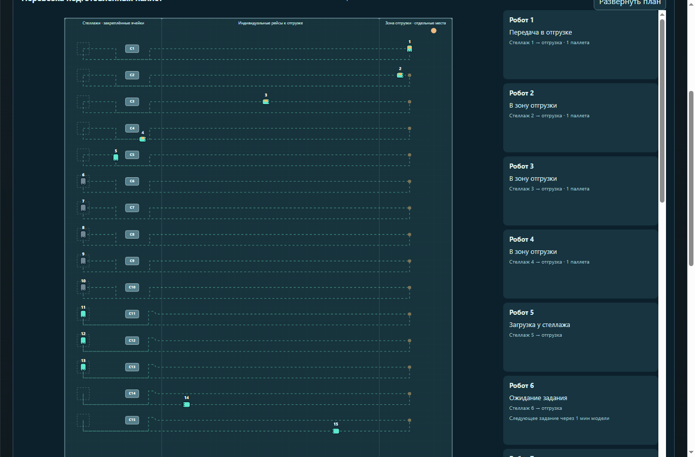

Плюсы: видны индивидуальные рейсы каждого робота от своего стеллажа к отгрузке; схема, номера роботов и статусы есть. Проблема: это длинная регулярная диаграмма из одинаковых полос. Человеку, знающему склад, она похожа на лабораторный стенд, а не на его помещение: нет ворот, проходов, колонн, ширин, зон пересечения, источника масштаба и ограничений. Правая колонка из 15 карточек заставляет прокручивать и не выделяет главную проблему.

## Склад: 3D

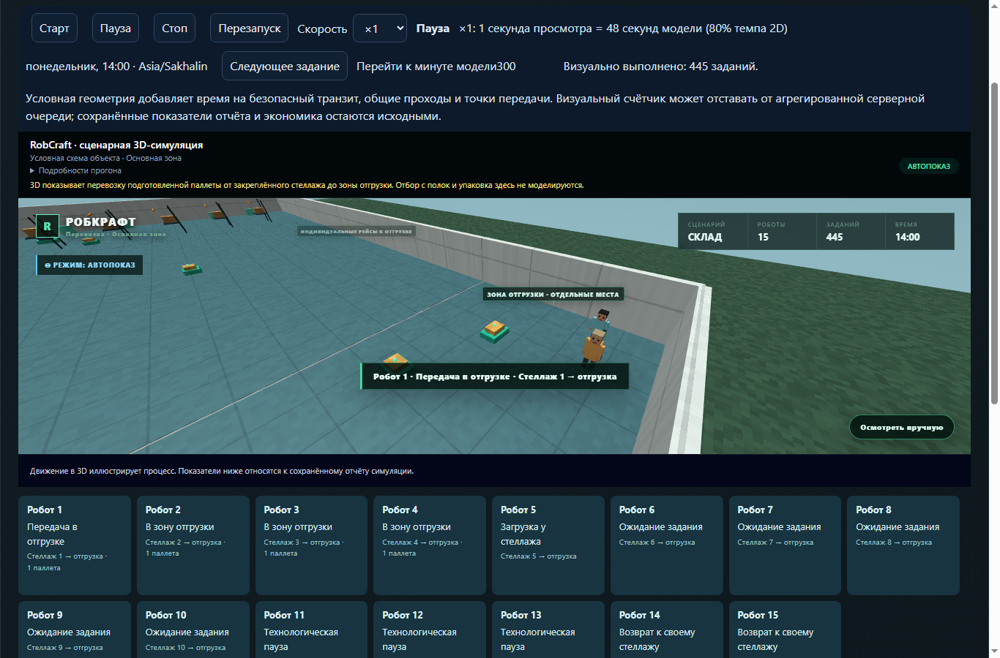

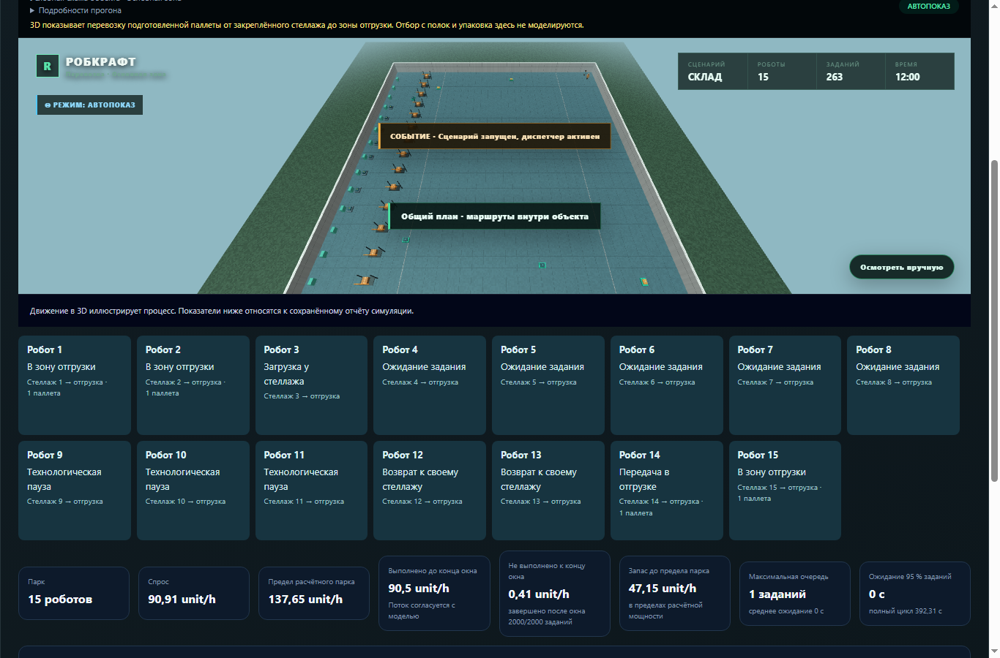

Плюсы: сохранённые 2D/3D используют общие координаты и расписание безопасной сцены. Есть стены, груз, маркировка, оператор и сопровождение робота. Проблема: огромный пустой пол, повторяемые предметы и дальняя камера делают склад похожим на макет; роботы и узкие места теряются. Слишком много служебного текста и карточек конкурирует с самой сценой. Старый более насыщенный ракурс ниже полезен как **референс выразительности**, но не как достоверный план:

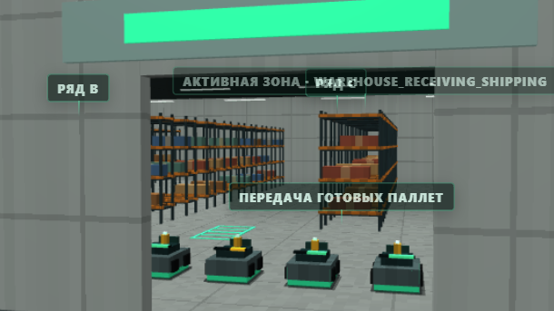

Крыша, богатые материалы, свет, люди и детали могут работать как художественный слой. При их возвращении нельзя показывать выдуманные стеллажи/проходы как реальные или пропускать робота через визуальное препятствие. Нужны единая карта препятствий и маркировка происхождения геометрии.

## Остальные шаблоны

| 2D | 3D |
| --- | --- |
| 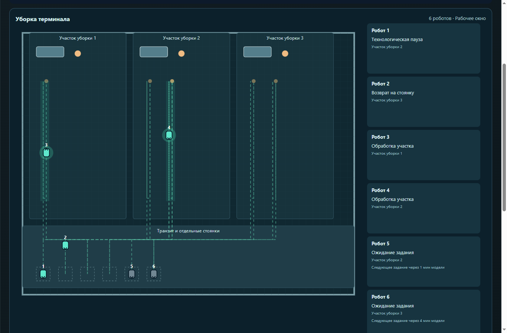 | 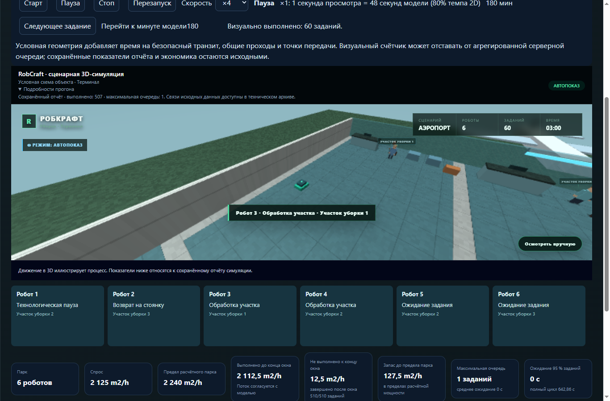 |
| 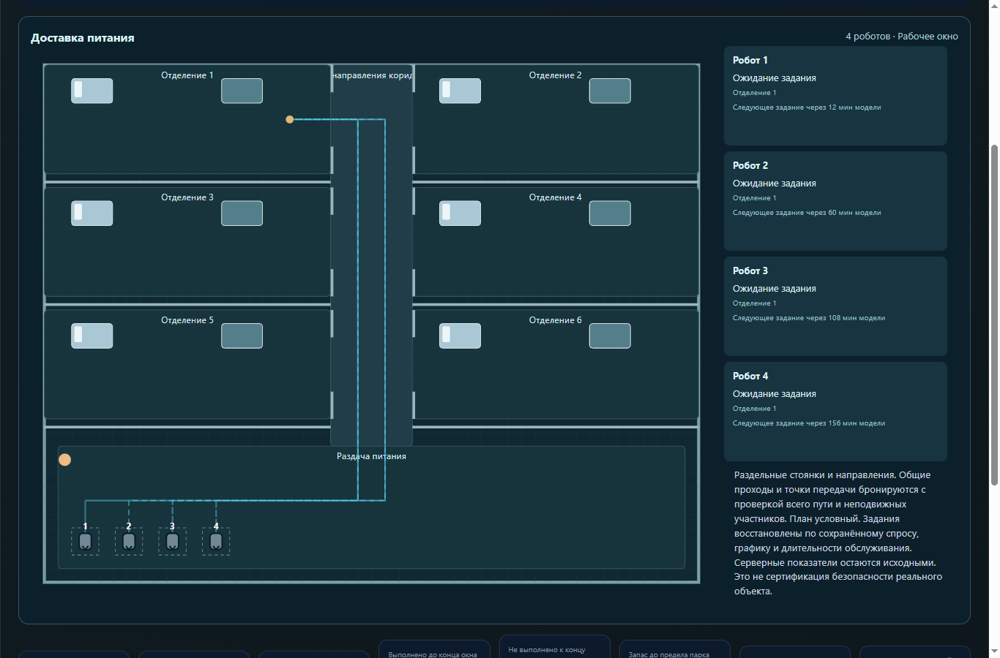 | 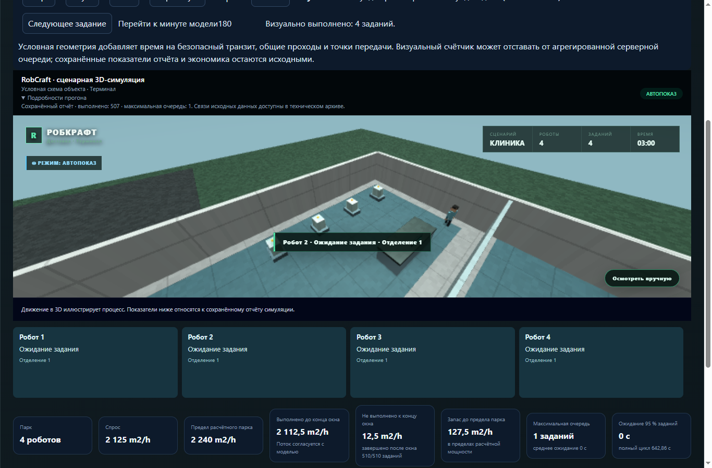 |

Эти сцены демонстрируют широту движка, но для финальной истории лучше показывать **один убедительный складской кейс глубоко**, а другие объекты оставить короткими примерами применения. Аэропорт и клиника также условные; на кадрах нет проверенного плана конкретного объекта.

## Ключевая дизайнерская гипотеза

Доверие даст не только более детальная графика, а цепочка «мой/примерный план → выбранный робот → видимый риск на маршруте → изменение очереди/производительности → денежное следствие». На экране нужно отличать:

1. **Подтверждено вводом/замером** — загруженный план, масштаб, измеренная нагрузка.
2. **Предположение сценария** — ширина коридора, время погрузки, цена, персонал.
3. **Вычислено моделью** — парк, ожидание, пропускная способность, эффект.
4. **Декорация** — крыша, свет, люди и детали, не участвующие в расчёте.

Не стоит прятать эти различия в технический `details`: короткая легенда и карточка «почему результат такой» должны быть рядом с визуализацией. Клик по очереди/затору может выделить место и показать вклад в потерянное время; клик по изменённому входу — показать пересчитанные показатели и разницу в деньгах. Показатель без серверного источника обозначать как иллюстрацию.
